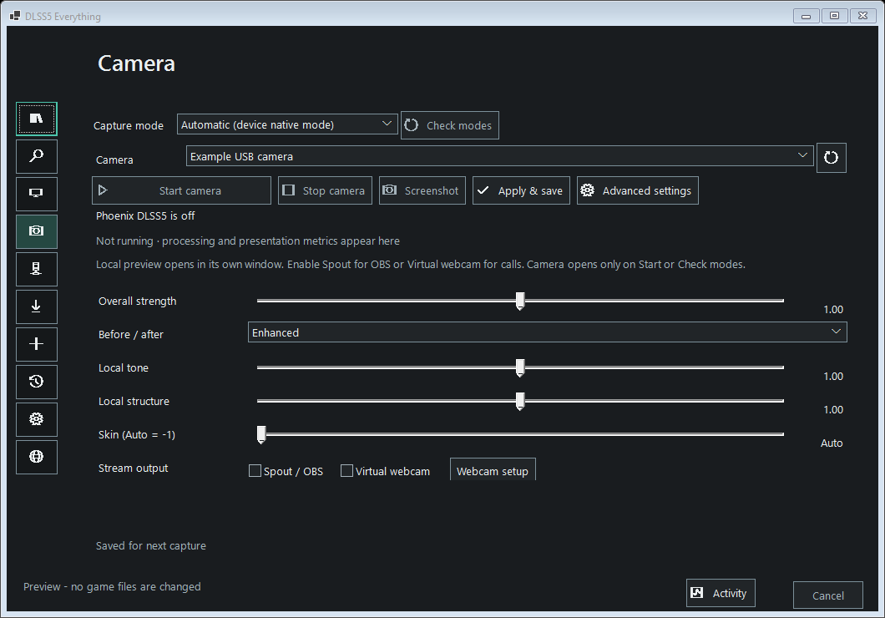

# Camera

**Camera** enhances a camera feed with the same fast native Phoenix path and
controls used by Screen Studio. It does not require installation into a game.

Preview with an example device; no camera is running in this screenshot.

1. Set up the compatible Phoenix/ReShade components and a separately supplied
   model in **Components**, as described in [Screen Studio](screen-studio.md).
2. Open **Camera**, select a device and press **Start camera**. The default
   **Automatic (device native mode)** uses a mode actually supported by that
   device. To choose explicitly, press **Check modes** first; it briefly opens
   the camera to discover its real resolution/frame-rate choices without
   streaming or saving images. Guessed 30/60 FPS profiles are not offered.
   A separate preview window displays the enhanced output. Nothing opens the
   camera until Start or the explicit Check modes action. Only video is acquired; no microphone is opened.
3. Adjust overall strength, local tone, local structure, skin and before/after.
   While running, camera changes apply and save automatically after a short pause in editing.
   **Apply & save** also sends them immediately. Advanced settings expose scale,
   processing iterations, frame cap, mask, effects and the existing Phoenix
   live-control dialog. Advanced Phoenix settings remain session-only.
4. Press **Stop camera**, close its preview, or exit the app to release the
   camera, processing host and output senders. Switching tabs keeps an active
   feed running. Closing to the tray follows the existing app preference;
   use Stop or Exit to end it.

Capture mode is negotiated and checked. Unsupported explicit modes produce an error
rather than silently substituting another size. Automatic chooses a native
default; older saved choices from the guessed-profile picker migrate to
Automatic. Device-reported choices can be saved and restored. Requested 30/60 FPS accepts
the corresponding fractional rate within 0.1 FPS. Actual delivered size and
camera rate appear in telemetry; processing FPS can be lower than camera FPS.
Only one pending read/frame is held, so inference cannot accumulate a growing
queue of stale video. Mode changes require Stop/Start. Device identity, mode,
basic controls and presets are saved separately in `camera-studio.json`.
The camera is never automatically restarted when loading that file. The first
asynchronous frame request starts only after the processing host is ready;
camera startup cannot leave an old pending request stalled during host setup.

## OBS and calling apps

- **Spout / OBS:** add a Spout2 Capture source in OBS and select **DLSS5 Camera**
  (or the sender name set under Outputs). This shares GPU textures directly;
  OBS needs its separately installed Spout receiver plugin.
- **Virtual webcam:** install [OBS Studio](https://obsproject.com/download) with
  its Windows Virtual Camera component. Enable **Virtual webcam** here, then
  select **OBS Virtual Camera** in Discord, Zoom or another desktop camera app.
  OBS itself can stay closed. Phoenix publishes directly to that component's
  shared-memory input. Another OBS/Phoenix sender cannot use it simultaneously;
  conflicts are reported and the existing sender is preserved.
- Both outputs can run together. They publish the same composed view as the
  preview, including deliberate comparison/bypass modes. Turn off comparison
  to send the enhanced view. Turning a sender off releases it promptly.
- **Webcam setup** links to camera permissions and the OBS download. The app
  does not silently install/register a webcam driver. Refresh after installation.
  The OBS output camera is excluded from the input picker to prevent feedback.

Virtual webcam output is SDR, limited-range BT.601 NV12. It adds GPU readback
and color conversion for the external DirectShow filter; Spout stays on the GPU.
Camera input is converted to RGB32 by Windows Media Foundation, uploaded once,
then sent through the existing shared-GPU Phoenix transport and compositor.
Video-only color input uses flat depth/zero motion, as in Screen Studio; this
is not temporal DLSS Super Resolution. HDR camera capture is unavailable.

No recording or automatic screenshot capture is added. **Screenshot** is an
explicit action and uses the existing input/enhanced/displayed image export.

## Build and checks

Build the native worker with `source\screen\build-screen.bat`, then build the
.NET app. Media Foundation comes with the Windows SDK; no new capture package
or OBS source/runtime is bundled. External SDK locations can be supplied with
`PHOENIX_SOURCE_DIR` and `SPOUT_SOURCE_DIR` as before. The default Spout search
also accepts `..\external\Spout2` in this workspace.

- `CameraStudioTests`: device identities, feedback prevention, validation,
  settings separation, compact/light UI, no automatic camera startup.
- `tests\build-camera-tests.bat`: callback completion/error handling and
  BT.601 conversion, including padded input rows and channel ordering.
- `tests\build-camera-tests.bat --virtual-output`: GPU readback, queue
  metadata, sender conflict rejection and shutdown. Opt-in GPU test.
- `--read-generated-video <absolute-path>` on that test executable qualifies
  the exact asynchronous camera reader using a generated 1280×720/30 FPS clip
  with red top/blue bottom halves. This tests decoded pixels and orientation
  without opening a personal camera.
- `--serve-fixture` emits synthetic red frames for up to 30 seconds. A
  DirectShow consumer can explicitly read **OBS Virtual Camera** to qualify
  actual delivery. It refuses to replace an existing producer.

The queue implementation interoperates with the public layout and lifecycle
of OBS's [shared-memory camera protocol](https://github.com/obsproject/obs-studio/blob/master/shared/obs-shared-memory-queue/shared-memory-queue.c).
The external filter remains part of OBS and is not redistributed here.
Windows camera input follows Microsoft's [Media Foundation capture API](https://learn.microsoft.com/en-us/windows/win32/medfound/audio-video-capture-in-media-foundation).
The selected Elgato Virtual Camera was also qualified through the actual
capture → native Phoenix → visible preview path at its native 1920×1080/60
capture mode, with live strength changes and clean Stop; no camera images
were saved. Its reported modes were 1920×1080, 1280×720 and 960×540 at 60 FPS.
This is a tested input mode, not a claim of 60 FPS processing. Other physical
camera hardware, unplug/reconnect behavior and individual calling-app
compatibility still need qualification.
