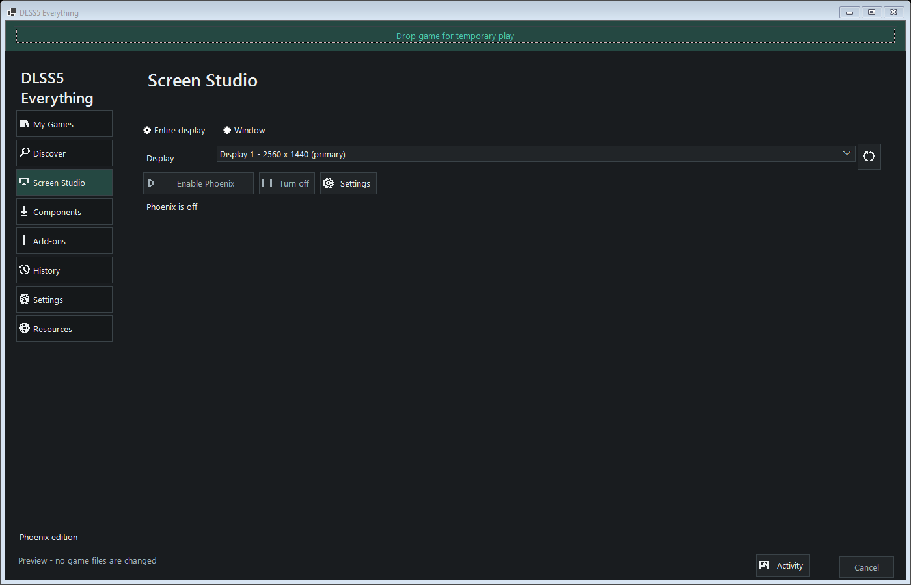

# Screen Studio

## Component Compatibility

Normal application startup downloads/checks ReShade and the published Phoenix DLSS5 addon. Screen Studio requires a Phoenix DLSS5 build with the direct feeder API and embedded C++ runtime. The public `0.8-beta` addon lacks that API and is rejected before replacing an existing component; repeated downloads of that binary cannot enable Screen Studio. Until a compatible release is published, explicitly import a compatible local Phoenix DLSS5 build through Components (or `--components-import`, described in [Phoenix DLSS5 migration](phoenix-migration.md)). A previously imported local build is preserved during routine updates. The compatible model DLL is supplied separately, not automatically downloaded. Component success is not a claim that desktop capture or inference has passed validation.

Choose **Entire display** or **Window**, select the target, and click **Enable Phoenix DLSS5** to see the enhanced output live. This independent frontend does not inject into the captured application or install files in its folder. It is experimental, not a claim of complete NeuralScreen parity.



Preview with an example source, not a live capture. Advanced controls are collapsed by default.


## Start A Capture

1. In **Components**, provide ReShade x64 with full add-on support, a Phoenix DLSS5 build with the direct feeder API and embedded C++ runtime, and a compatible separately obtained model. The same component library is used by the game installer. Screen Studio does not download NeuralScreen or its bundled DLLs.
2. Open **Screen Studio**, choose **Entire display** or **Window**, and select the target. The picker only lists that type of target. Entire display covers every application on the selected monitor; this is one monitor per session, not simultaneous multi-monitor enhancement. Refresh the picker if a window was just opened. Capture never starts automatically.
3. Click **Enable Phoenix DLSS5**. It starts enhanced-only viewing even if a previously saved preset used bypass or differences. The default is 100% processing scale, one iteration, and a 60 FPS ceiling. For a selected window, the explicit Enable action attempts to bring it forward once, but only if this app still has focus; Windows may deny activation. The presenter never repeatedly takes focus. A window's output overlay is hidden while another application is in front, and the main status reports that it is in the background. Minimized/hidden windows pause capture.
4. **Turn off** removes the enhanced overlay and stops this capture and its owned host. The display/window picker stays available while running: choose a different target, then click **Switch target**. The old capture is stopped before the selected one starts. A hotkey bypass or comparison can also be returned to enhanced viewing with **Enable Phoenix DLSS5**, without applying unrelated staged slider values or restarting the host.
5. Strength, tone, structure, skin and before/after comparison are available in the basic view. **Screenshot**, status and processing/presentation telemetry remain visible. Open **Advanced settings** for processing scale, camera, output and hotkey options. **Apply & save** sends staged basic settings and saves them for the next capture. Moving a slider alone does not restart anything. Cursor capture, HDR transport and hotkey changes require turning capture off/on.
6. **Screenshot**, or the configured screenshot hotkey, saves three images: `normal` (captured input), `enhanced` (processed image at processing size), and `view` (full-size displayed composition, including comparison/camera effects). PNG is lossless; JPEG is optional. Capture works for still windows too, using the last captured frame when a screenshot or settings change is requested.

Advanced Phoenix controls clearly identify changes that last only for the current
capture. Only basic strengths/mask are synchronized back to Screen Studio; save
those basic settings there if they should survive restarting capture. Named
presets contain basic capture settings. Saving or deleting a preset does not
silently replace the default settings or the persistent On/Off status line.

Closing the app stops capture; the existing close-to-tray preference keeps it alive until an actual exit or **Turn off**. Temporary capture files and the session runtime are removed on Stop/Dispose. Exported screenshots remain in the selected folder. If screenshot export fails, completed unexported PNG triplets are retained in `%LOCALAPPDATA%\DLSS5-Everything\ScreenSessions\recovered\<session-id>`. If recovery itself fails, the original session directory is retained to avoid losing those captures.

Default global hotkeys use **Ctrl+Alt**: End stops, F8 toggles enhancement, F9 cycles enhanced/input/wipe/difference, F10 captures screenshots. They are registered only while capture is active, reject conflicts, and can be remapped in the Capture tab. Hotkeys do not apply unrelated staged sliders.

## Sharing

Enable **Spout GPU sender**, choose a sender name and Apply. A Spout-compatible receiver such as OBS with its Spout capture plugin can select the sender. Sharing does not require screen-grabbing the excluded overlay. Sender-name changes recreate the sender. The BSD-licensed Spout SDK is compiled into our worker; no separate Spout DLL download is needed. Source and receiver must use compatible GPU adapters. Turning Spout off unregisters the sender even while the captured window is hidden or minimized.

## HDR Transport

Enable **HDR scRGB transport** before starting capture on an HDR display. Capture, presentation and Spout use RGBA16F scRGB. Phoenix DLSS5 still processes an SDR-conditioned image; this is **not native HDR model inference**. Paper white (80..400 nits, default 203) sets conditioning scale. With detail preservation enabled, the linear-light model residual is added to the original HDR capture, preserving values outside the SDR conditioning range. Disable detail preservation only when deliberately replacing that original HDR range with the conditioned result. PNG/JPEG screenshots remain SDR. This option does not change Windows HDR settings. Physical HDR-display color accuracy has not been validated; transport remains experimental.

## Image And Video Conversion

Stop capture, then choose **Media > Convert image / video**. Select a PNG/JPEG/BMP image or video and a **new** output filename. Images export as opaque SDR PNG; original transparency and embedded color profiles are not preserved. Processing uses the currently staged Screen Studio enhancement/scale/iterations/camera settings, with enhanced-only composition. Input files are never modified. Conversion does not capture the screen or inject into another application.

Video additionally requires your own [FFmpeg and FFprobe](https://ffmpeg.org/download.html), with `ffprobe.exe` beside the selected `ffmpeg.exe`. No FFmpeg executable is bundled or downloaded. Choose H.264 CPU (`libx264`) or NVIDIA DLSS5 NVENC (`h264_nvenc`), quality 0..51 (lower is higher quality), and whether to retain the source's first audio stream (re-encoded AAC). The installed FFmpeg build must provide the selected encoder. Video is decoded to SDR PNG frames, each is processed, then encoded to MP4. Variable-frame-rate input is normalized to its validated average frame rate; this is not frame generation. HDR-tagged video is rejected, not silently passed through SDR. Odd image dimensions receive up to one black padding pixel for H.264.

Each job is limited to 2,000 frames and 4 GiB of decoded/processed temporary images. Processing canvases have the same limits as live capture. Progress shows decoding, per-frame processing and encoding; Cancel stops owned workers/tools and removes temporary files. Output is published only after successful completion; existing files are never overwritten. This is a bounded offline tool, not a general-purpose long-video editor.

## Processing And Limits

Windows Graphics Capture supplies a D3D11 surface. The worker converts it to an RGBA shared GPU texture, exchanges fences with the existing D3D12 Phoenix DLSS5 host, and presents only after completed output is returned. No per-frame CPU image transport is used for live enhancement or Spout. CPU readback occurs for requested screenshots and offline image export. Capture exclusion is required for the output window; failure stops the session rather than risking a feedback loop.

This is a captured-image enhancement route: **flat depth and zero motion vectors**, not a game-native DLSS input contract. Missing geometry and motion can affect temporal quality. It does not process headset eye submissions or exclusive-fullscreen applications. Protected content can be blank or refuse capture. Windows 10 2004 or newer, a compatible GPU, drivers and model are required. HDR-active displays require explicit HDR transport rather than treating HDR bytes as SDR.

The updated Phoenix DLSS5 native runner generates plans for custom resolutions. Screen Studio forwards the exact processing dimensions instead of selecting/padding to four presets. At the default 100% scale, capture and processing are 1:1, including odd-sized, portrait, 1440p and 4K images. Each axis must be between 1 and 16384 pixels; actual allocation/inference is still limited by GPU capabilities, memory and the selected backend. A large allocation can fail and is reported rather than silently resized. Explicitly lower processing scale when needed for memory or performance. Older local addons may expose the feeder API but still lack dynamic-resolution support; update the addon as well as the app.

Reducing processing scale is explicit. With **Preserve full-resolution detail**, the compositor adds the processed-minus-small-input residual to the original full-resolution image. Without it, the smaller result is spatially scaled to the capture size. Neither path calls DLSS Super Resolution or DLAA. This does not increase the resolution of the application itself.

Comparison modes are enhanced, unmodified input, input/enhanced wipe, and absolute RGB difference with adjustable gain. Camera effects apply only to the enhanced side; input stays an honest baseline. Presets save the basic Screen Studio controls, media settings and hotkeys, with a maximum of 40. **Phoenix DLSS5 controls** exposes the external backend's advanced settings for the current session; basic strengths are synchronized on return. Other advanced changes are session-only and are not part of these presets.

## Feature Checklist

The feature reference is [NeuralScreen](https://github.com/perseval-BLR/NeuralScreen), inspected at revision `4a9ee16d486668099a12296eabaa9ffe34704744`. Its [PolyForm Strict license](https://github.com/perseval-BLR/NeuralScreen/blob/4a9ee16d486668099a12296eabaa9ffe34704744/LICENSE) does not permit copying its implementation into this project. This frontend uses our existing Phoenix DLSS5 host and independently implemented Windows SDK capture/presentation code. NeuralScreen code, binaries, configuration files and vendor payloads are not included or downloaded.

| Capability | This implementation |
| --- | --- |
| Whole-display and per-window capture | Windows Graphics Capture; window resize/move/minimize handling |
| GPU capture/processing/presentation | Shared D3D11 textures and D3D12 host fences; one in-flight processed frame |
| Enable/bypass, local tone/structure/skin and mask | Wired to worker/Phoenix DLSS5, with staged Apply |
| Repeated processing | 1..10 host evaluations per frame |
| Reduced processing resolution/detail preservation | Explicit 25..100% scale, native-canvas padding, residual composition |
| Wipe/differences | Four view modes, divider and difference gain |
| Camera treatment | Lens/FOV, vignette, chromatic aberration and noise |
| Screenshots | Separate normal/enhanced/displayed-view PNG or JPEG, custom output folder |
| Presets and remappable shortcuts | Local settings/presets, conflict-checked Ctrl+Alt hotkeys |
| GPU/model execution controls | Existing Phoenix DLSS5 controls; native inference architecture/geometry restrictions still apply |
| NVENC | Explicit FFmpeg NVENC option for video conversion |
| Spout | GPU sender for SDR or float HDR composition; BSD SDK compiled into worker |
| File conversion | Opaque SDR images and bounded SDR video jobs; separate FFmpeg required for video |
| HDR output | Experimental float capture/presentation, SDR-conditioned model residual; screenshots remain SDR |
| Frame generation / optical-flow motion | **Skipped by request**; no unavailable SDK controls or downloads |
| Automatic startup/tray/languages | Existing app-level tray/appearance/localization; no automatic capture at startup; Screen Studio labels currently English |

## Validation

Native CPU contracts cover bounds, non-finite values, scaling, sharing/HDR options and supported canvas selection. Focused .NET tests cover settings/presets, media validation, acknowledgement parsing, cleanup/recovery, startup cancellation, operation ownership, layout and staged controls. Offscreen UI renders exercise dark/light themes at 1060x740, 1400x900 and 1920x1080 without Computer Use. Live tests are opt-in and skipped in ordinary CI.

Controlled-window GPU tests passed with generated content: bypass pixels, scale/resize, actual neural changes, screenshots and shutdown. Additional tests passed for float-HDR window transport/bypass screenshots, image conversion (exact bypass and measurable neural change), and three-frame video conversion with verified output codec/rate/dimensions/frame count. A native synthetic test recovered matching pixels through Spout. Physical HDR color accuracy is **not live-validated**. The local whole-display fix now passes the controlled feedback-exclusion test: the worker verifies capture exclusion, and two complete captured inputs match generated source pixels while a contrasting output overlay is visible. Transient driver startup notifications must settle; the exact pixel oracle is unchanged. The initial failed attempt is retained in the audit. This test still requires explicit opt-in on an idle, personal-content-free test desktop; see `local-build/validation-current/FIXES.html` for the candidate identity and receipts. These are synthetic capture/host tests, **not game, VR, performance or image-quality certification**. Tests, logs, local component paths and captures remain outside the public package.

The dynamic-resolution feeder build additionally passed synthetic GPU image conversions at **257x255** and **2560x1440** with native-size output, exact bypass pixels, unchanged source files and measurable enabled enhancement. CPU contracts cover portrait/4K dimensions and extent bounds; those contracts alone are not GPU validation at every resolution. Importing the actual older public addon was also rejected without changing the compatible addon or its provenance.

Live tests also exercise the view's actual Enable/Switch workflow between two owned synthetic windows and min/max strength changes. Phoenix DLSS5 acknowledged tone/structure 2.0 and the returned images differed by mean RGB 9.6125/255 from the zero-strength case. This is control/processing evidence, not a quality claim for arbitrary desktop content. Presentation diagnostics separately count accepted DXGI presents and report overlay visibility/target foreground; a background window intentionally has no visible overlay. The first output is made visible before Present when its target is foreground, and shutdown hides the overlay before releasing capture resources. A small numeric/status summary is saved locally at `%LOCALAPPDATA%\DLSS5-Everything\ScreenDiagnostics\last-session.json` before temporary-session cleanup; it does not copy screenshots, source-window titles or media-folder settings. No diagnostic files enter the app package or repository.

```powershell
# Build the first-party worker and run its CPU contracts.
.\scripts\Fetch-ScreenDependencies.ps1
.\source\screen\build-screen.bat
dotnet test Dlss5DxCompat.sln -c Release

# Explicit opt-in, with a compatible separately supplied local payload.
$env:DLSS5_SCREEN_LIVE_PAYLOAD = '<absolute local component folder>'
$env:DLSS5_SCREEN_LIVE_NEURAL = '1'
dotnet test Dlss5DxCompat.sln -c Release --filter 'FullyQualifiedName~ControlledWindowCaptureRoundTripsGpuAndResizes'

# Separately opt into whole-display capture ONLY on an idle test desktop.
$env:DLSS5_SCREEN_LIVE_MONITOR = '1'
dotnet test Dlss5DxCompat.sln -c Release --filter 'FullyQualifiedName~SyntheticMonitorDoesNotCaptureItsEnhancedOverlay'
```

The live payload folder must contain `ReShade64.dll`, compatible `phoenix.addon64`, and the model `nvngx_dlssnr.dll`. Ordinary tests and CI skip live capture/inference. The worker build requires Visual C++/Windows SDK C++/WinRT headers, the existing `PHOENIX_SOURCE_DIR` JSON header and pinned Spout source (`SPOUT_SOURCE_DIR`, fetched by the script). It does not require Python or NeuralScreen. `tests/build-screen-media-tests.bat` builds an explicit GPU Spout test after the worker build; run the resulting test executable without arguments. Media live tests also accept `DLSS5_SCREEN_LIVE_FFMPEG` for the separate local FFmpeg executable.

References: [Windows Graphics Capture](https://learn.microsoft.com/en-us/windows/apps/develop/media-authoring-processing/screen-capture), [capture exclusion](https://learn.microsoft.com/en-us/windows/win32/api/winuser/nf-winuser-setwindowdisplayaffinity), [layered-window hit testing](https://learn.microsoft.com/en-us/windows/win32/winmsg/window-features), [WIC PNG formats](https://learn.microsoft.com/en-us/windows/win32/wic/-wic-codec-native-pixel-formats), and [Phoenix DLSS5](https://github.com/RazvanManolache/dlss5-phoenix-addon).

Media references: [Spout2](https://github.com/leadedge/Spout2/tree/6b68a5b4fdeca6130b851e5f9366467a844860e5), [FFmpeg](https://ffmpeg.org/), [OBS Spout plugin](https://github.com/Off-World-Live/obs-spout2-plugin).
